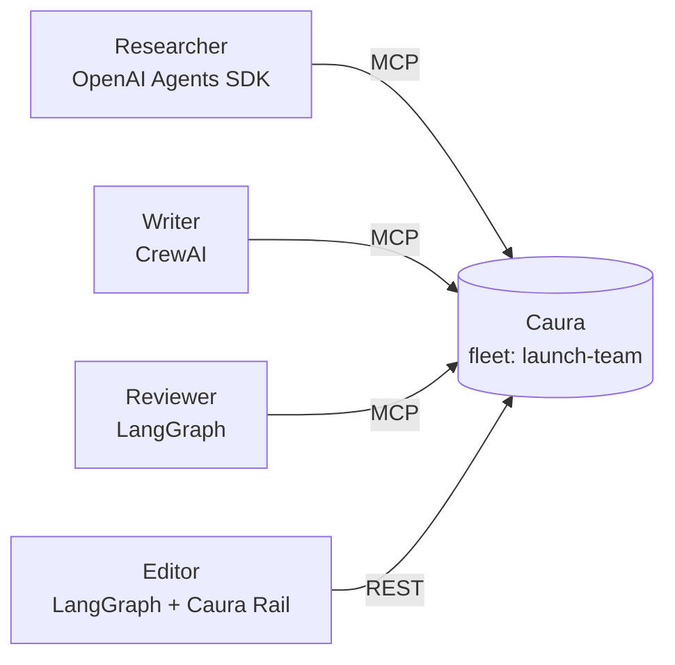

<h1 align="center">Caura Cross-Framework Fleet</h1>

<p align="center">
  <strong>One shared memory for agents built on OpenAI Agents SDK, CrewAI and LangGraph.</strong><br/>
  Three agents on three frameworks work on one product launch. What one agent learns or corrects<br/>
  reaches the others through <a href="https://github.com/caura-ai/caura">Caura</a>, with no agent talking to another directly.
</p>

<p align="center">
  <a href="https://caura.ai/docs"></a>
  <a href="https://github.com/caura-ai/caura"></a>
  <a href="https://openai.github.io/openai-agents-python/"></a>
  <a href="https://docs.crewai.com"></a>
  <a href="https://docs.langchain.com/oss/python/langgraph/overview"></a>
  
  <a href="LICENSE"></a>
</p>

<p align="center">
  <a href="#what-is-caura">Caura</a> ·
  <a href="#demo">Demo</a> ·
  <a href="#the-problem">The Problem</a> ·
  <a href="#how-it-works">How It Works</a> ·
  <a href="#quickstart">Quickstart</a> ·
  <a href="#try-it-without-a-model-key">No-key Run</a> ·
  <a href="#troubleshooting">Troubleshooting</a> ·
  <a href="#validation">Validation</a> ·
  <a href="https://caura.ai/docs">Docs</a>
</p>

---

> _Three frameworks. One fleet. One source of truth._
> The Reviewer on LangGraph fixes a wrong fact, and the Researcher on the OpenAI Agents SDK gets the right answer on its next recall.

---

## What is Caura

[Caura](https://github.com/caura-ai/caura) (formerly MemClaw) is open-source, governed, shared memory for AI agent fleets. Agents write plain text; Caura stores it as searchable memory scoped to a fleet, with a lifecycle (`active`, `outdated`, ...), per-agent attribution and an audit trail. It speaks MCP over streamable HTTP, so any framework with an MCP client can use it.

This repo is a **use-case implementation**: the same Caura fleet shared by agents on four different stacks, with no glue code between the agents.

> **Do you need a Caura API key?** No. Everything runs on the open-source Caura server on your own machine. The only key you need is for the model your agents think with. An [OpenRouter](https://openrouter.ai) key works.

<p align="center">
  <a href="https://github.com/caura-ai/caura"><strong>Caura source (Apache 2.0)</strong></a> ·
  <a href="https://github.com/caura-ai/caura-rail"><strong>Caura Rail SDK</strong></a> ·
  <a href="https://caura.ai"><strong>Managed platform</strong></a>
</p>

---

## Demo

| Step | Agent | Framework | What it does |
|---|---|---|---|
| 1 | Researcher | OpenAI Agents SDK | Saves three facts from the v1 pricing notes |
| 2 | Writer | CrewAI | Recalls those facts and drafts a launch note |
| 3 | Reviewer | LangGraph | Reads the October changelog, marks the old rate limit as outdated, stores the new one |
| 4 | Researcher | OpenAI Agents SDK | Is asked the rate limit again and answers 60, where it said 100 before |
| 5 (optional) | Editor | LangGraph with Caura Rail | Writes the final announcement, reading memory over REST |

Output from a run with a real model (`openai/gpt-5.4-mini`):

```text
[1] Researcher (OpenAI Agents SDK) stores the v1 facts
Stored 3 facts.

[2] Writer (CrewAI) drafts from team memory
The pricing API free tier includes 10,000 calls per month. It allows 100 requests per minute per key.
The pricing API caches responses for 5 minutes at the edge.

[3] Reviewer (LangGraph) checks memory against the October changelog
Changed:
- Marked the old team memory as outdated: "The pricing API allows 100 requests per minute per key."
- Stored the corrected fact: "The pricing API rate limit is 60 requests per minute per key."

[4] Researcher (OpenAI Agents SDK) is asked the rate limit again
60 requests per minute per key.

[5] Editor (LangGraph + Caura Rail) writes the announcement
The pricing API rate limit is 60 requests per minute per key.

Result: the correction reached the Agents SDK agent
```

The wording changes from run to run. The last line should stay the same. Step 4 runs on a different framework than step 3, and the correction still arrives, because both agents read the same Caura fleet.

---

## The Problem

Teams rarely standardise on one agent framework. A research agent on the OpenAI Agents SDK, a CrewAI crew and a LangGraph workflow each keep their own memory, so they drift apart:

| Approach | Problem |
|---|---|
| Memory per framework | Each agent keeps its own copy. A correction in one never reaches the others. |
| Agents message each other | Every pair of frameworks needs glue code, and the facts live in chat history. |
| One shared vector store | No lifecycle. The old fact and the new fact both come back, and the model picks one. |

**Caura is the shared layer under all of them.** Every agent writes to and recalls from the same fleet over MCP or REST. When the Reviewer retires a fact, it is gone from everyone's recall, on every framework.

---

## How It Works



### How each framework connects to Caura

Caura serves MCP over streamable HTTP at `/mcp`, and all three frameworks have a client for it.

| Framework | Code | How it reaches Caura |
|---|---|---|
| OpenAI Agents SDK | [`openai_agents_sdk/researcher.py`](openai_agents_sdk/) | `MCPServerStreamableHttp` |
| CrewAI | [`crewai_agents/writer.py`](crewai_agents/) | `MCPServerAdapter` with the `streamable-http` transport |
| LangGraph | [`langgraph_agents/reviewer.py`](langgraph_agents/) | `MultiServerMCPClient` from `langchain-mcp-adapters` |
| LangGraph with Caura Rail | [`langgraph_rail/editor.py`](langgraph_rail/) | `caura-rail`, Caura's SDK over REST |

Each folder has its own README and runs on its own, for example `python -m crewai_agents.writer`.

### Agent identity is set in code

On a self-hosted Caura in standalone mode, the agent a call acts as comes from the `agent_id` argument of the tool call. If the model fills that in, one slip puts a memory under the wrong agent or fleet.

[`fleet_common/identity.py`](fleet_common/identity.py) handles this the same way for every framework:

- The model is offered three Caura tools: `caura_write`, `caura_recall` and `caura_manage`.
- Identity arguments (`agent_id`, `fleet_id`, `fleet_ids`, `visibility`) are hidden from the model's view of those tools.
- The code writes the real identity into every call and overwrites anything the model sends.

Writes use `visibility: scope_team`, so every agent in the fleet can recall them.

### How the correction works

```
Reviewer (LangGraph)
   caura_recall  "pricing API rate limit"     -> finds "100 requests per minute" + its id
   caura_manage  op=transition status=outdated -> retires it
   caura_write   "60 requests per minute"     -> stores the correction
                         |
                         v
Researcher (OpenAI Agents SDK)
   caura_recall  "pricing API rate limit"     -> active memories only: "60 requests per minute"
```

Caura can also detect conflicting facts on its own when an LLM provider is configured. This demo retires the old fact explicitly, so it behaves the same with or without a provider.

---

## Quickstart

### Prerequisites

- [Docker](https://www.docker.com/) (running)
- git and bash (on Windows, use Git Bash)
- Python 3.10 or newer (tested on 3.13)
- A key for any OpenAI-compatible model endpoint, for example [OpenRouter](https://openrouter.ai)

### 1. Clone the repo

```bash
git clone https://github.com/Infrasity-Labs/caura-cross-framework-fleet.git
cd caura-cross-framework-fleet
```

### 2. Start Caura

```bash
scripts/start-caura.sh        # open-source Caura on http://localhost:8000, no Caura key needed
```

The script clones Caura into `.caura/`, switches off Caura's own LLM features and starts it with Docker Compose. The only model calls are the ones your agents make. When it's ready it prints:

```text
{"status":"ok","storage":"connected","redis":"connected","event_bus":"ok"}
Caura is up. MCP endpoint: http://localhost:8000/mcp
```

### 3. Install the agents

**macOS / Linux**

```bash
python -m venv .venv && source .venv/bin/activate
pip install -r requirements.txt
```

**Windows (Git Bash)**

```bash
python -m venv .venv && source .venv/Scripts/activate
pip install -r requirements.txt
```

### 4. Configure your model

```bash
cp .env.example .env          # put your model key in LLM_API_KEY
set -a && source .env && set +a
```

### 5. Run the demo

```bash
python run_demo.py --fresh --with-rail
```

`--fresh` gives the agents new names and a new fleet, so you can rerun the demo as often as you like. Stop Caura and delete its data with `scripts/start-caura.sh down`.

---

## Try it without a model key

[`tests/fake_llm.py`](tests/fake_llm.py) is a small scripted model that speaks the OpenAI protocol. It picks each tool call and writes each answer from what Caura really returned, so the run only succeeds when the shared memory works.

```bash
python tests/fake_llm.py 8765 &
LLM_BASE_URL=http://localhost:8765/v1 LLM_API_KEY=fake python run_demo.py --fresh --with-rail
```

It prints the same five steps and ends with `Result: the correction reached the Agents SDK agent`.

---

## Troubleshooting

<details>
<summary><strong><code>ports are not available ... 6379</code> when starting Caura?</strong></summary>

Something on your machine, usually a local Redis, already uses port 6379. Caura's services reach Redis inside Docker, so you can publish it on another host port:

```bash
REDIS_PORT=16379 scripts/start-caura.sh
```

`DB_PORT` and `API_PORT` work the same way for 5432 and 8000. If you move the API, set `CAURA_URL` to match.

</details>

<details>
<summary><strong><code>402 This request requires more credits, or fewer max_tokens</code>?</strong></summary>

OpenRouter checks your balance against the most tokens a reply could use. Every agent caps replies at `LLM_MAX_TOKENS` (default 4096). On a very low balance, lower it in `.env`, pick a cheaper model with `LLM_MODEL`, or add credit.

</details>

<details>
<summary><strong><code>401 User not found</code> from the model provider?</strong></summary>

The key in `LLM_API_KEY` was revoked or belongs to a deleted account. Create a new key. On Windows, also check that an old `LLM_API_KEY` user environment variable isn't overriding your `.env`.

</details>

<details>
<summary><strong><code>FLEET_SCOPE_FORBIDDEN</code> on a rerun?</strong></summary>

An agent stays in the first fleet it writes to. Run with `--fresh`, or change `FLEET_ID` together with a new `AGENT_SUFFIX`.

</details>

<details>
<summary><strong>The writer or researcher recalls nothing?</strong></summary>

Without an embedder, recall matches words. Write each fact so it stands on its own, for example "The pricing API caches responses for 5 minutes" rather than "Responses are cached for 5 minutes". For recall by meaning, follow Caura's [local embedder guide](https://github.com/caura-ai/caura/blob/main/docs/local-embedder.md).

</details>

---

## Validation

Run the tests with Caura up and no model key:

```bash
scripts/start-caura.sh
pytest
```

They play the whole story through the scripted model and check that:

- the CrewAI writer sees the facts the Agents SDK researcher stored
- the LangGraph correction reaches the Agents SDK researcher and the Rail editor
- each memory is credited to the agent that wrote it
- every framework offers the model exactly three tools and never an identity argument

---

## Using Caura's managed platform instead

Point the same code at your managed account:

```bash
export CAURA_URL=https://caura.ai
export CAURA_API_KEY=mc_your_api_key
```

For a production fleet, give each agent its own credential. Caura's [per-agent keys guide](https://caura.ai/docs/integrations/per-agent-keys/) shows how.

---

## Things to know before you build on this

1. **An agent stays in the first fleet it writes to.** Writing to a different fleet later returns `FLEET_SCOPE_FORBIDDEN`.
2. **Recall matches words until you add an embedder.** See [Troubleshooting](#troubleshooting).
3. **The model needs tool calling.** Pick a model that supports it on your provider.
4. **The start script is for local use.** Standalone mode has one tenant and no API key check.

---

## Repository Structure

```
.
├── run_demo.py              <- Plays the five steps in order
├── fleet_common/
│   ├── config.py            <- Caura and model settings, all from environment variables
│   ├── identity.py          <- Hides identity arguments from the model and writes them in code
│   └── scenario.py          <- Role prompts, tasks and the pricing notes every framework uses
├── openai_agents_sdk/       <- Researcher (MCP)
├── crewai_agents/           <- Writer (MCP)
├── langgraph_agents/        <- Reviewer (MCP)
├── langgraph_rail/          <- Editor (Caura Rail over REST)
├── scripts/start-caura.sh   <- Starts or stops the open-source Caura server
└── tests/
    ├── fake_llm.py          <- Scripted OpenAI-compatible model for key-free runs
    ├── test_demo_flow.py    <- End-to-end story against a running Caura
    └── test_identity.py     <- Unit tests for identity binding
```

---

## Tested with

| Component | Version |
|---|---|
| Caura server (open source) | 3.34.0 |
| Python | 3.13 |
| openai-agents | 0.20.0 |
| crewai | 1.15.28 |
| langgraph | 1.2.15 |
| langchain-mcp-adapters | 0.3.2 |
| caura-rail | 1.0.2 |

---

## Related

- [Caura on GitHub](https://github.com/caura-ai/caura), the open-source server
- [Caura Rail](https://github.com/caura-ai/caura-rail), the Python and TypeScript SDK used in `langgraph_rail/`
- [caura.ai](https://caura.ai), the managed platform and docs

---

<p align="center">
  <strong>Built on <a href="https://caura.ai">Caura</a>: governed, shared memory for AI agent fleets.</strong><br/>
  <a href="https://github.com/caura-ai/caura">Source (Apache 2.0)</a> ·
  <a href="https://caura.ai/docs">Documentation</a> ·
  <a href="LICENSE">License</a>
</p>
